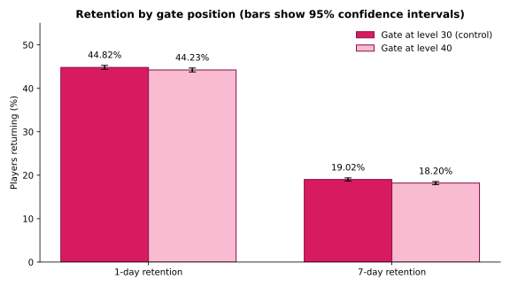
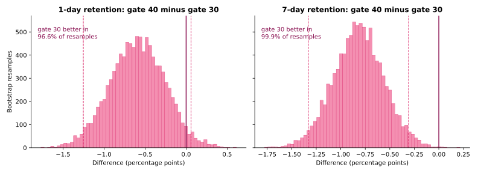
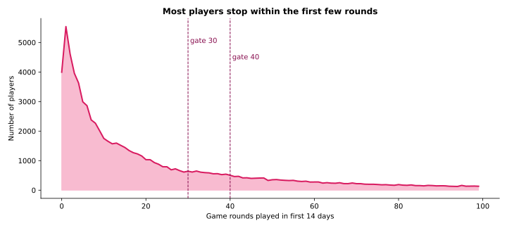

# A/B Test Analysis: Does Moving a Game's First Gate Change Player Retention?

An analysis of a randomised experiment on 90,189 players of the mobile game *Cookie Cats*: checking the experiment's validity, testing the effect on 1-day and 7-day retention with a z-test and a bootstrap, and recommending which version to keep.

**Python · pandas · matplotlib · statsmodels · SciPy · A/B testing · two-proportion z-test · bootstrap · power analysis**

## Questions

1. Did moving the first progression gate from level 30 to level 40 change how many players come back after 1 day and after 7 days?
2. Is the difference real, or could it be random noise?
3. Which version should the company keep?

## Background

*Cookie Cats* is a puzzle game by Tactile Entertainment. As players progress they hit "gates" that make them wait or pay before continuing. New players were randomly assigned to a version with the first gate at level 30 (control) or at level 40 (treatment).

## Data

From the DataCamp project *Mobile Games A/B Testing with Cookie Cats* (data from Tactile Entertainment). A copy is included in `data/`.

- 90,189 players, one row each, no missing values or duplicates
- `version`: gate at level 30 or level 40
- `sum_gamerounds`: rounds played in the first 14 days
- `retention_1`, `retention_7`: whether the player came back 1 and 7 days after installing

## Method

1. **Validity checks.** Tested the group sizes against a 50/50 split (sample ratio mismatch test) and inspected the distribution of rounds played for outliers.
2. **Retention comparison.** Two-proportion z-tests with 95% confidence intervals for the difference in 1-day and 7-day retention.
3. **Bootstrap.** 10,000 resamples of each group as an assumption-free check on the z-test.
4. **Engagement.** Mann-Whitney U test on rounds played, since the distribution is extremely skewed.
5. **Power analysis.** The smallest difference the test could reliably detect at 80% power.

## Key findings

**1. Moving the gate to level 40 lowered 7-day retention.**

| | Gate at 30 | Gate at 40 | Difference | 95% CI | p-value |
|---|---|---|---|---|---|
| 1-day retention | 44.82% | 44.23% | −0.59 pts | −1.24 to +0.06 | 0.074 |
| 7-day retention | 19.02% | 18.20% | **−0.82 pts** | −1.33 to −0.31 | **0.002** |

The 7-day difference is statistically significant, including after a Bonferroni correction for testing two metrics. The 1-day difference points the same way but is not significant.



**2. The bootstrap agrees.** For 7-day retention, the level 30 gate came out ahead in 99.9% of 10,000 resamples, with a 95% interval of −1.33 to −0.31 points.



**3. Most players never reach either gate.** Half of all players play 16 rounds or fewer, and only 37% play at least 30 rounds. Any effect of the gate comes from that minority, which is why the overall differences are small.



**4. No clear difference in rounds played.** Medians of 17 and 16 rounds, near-identical means, and a borderline Mann-Whitney test (p = 0.051).

**5. The test was large enough for the 7-day result.** With about 45,000 players per group it could detect a 0.7-point difference in 7-day retention at 80% power. The observed 0.82 points is above that. The 1-day difference (0.59) is below the 0.9-point threshold, so a small 1-day effect cannot be ruled in or out.

## Recommendation

Keep the gate at level 30. There is no evidence that level 40 helps on any measure, and good evidence that it hurts 7-day retention. For every 100,000 installs, the level 30 gate keeps about 820 more players active after a week.

## Limitations

- **Sample ratio mismatch.** The groups are 49.56% and 50.44% of players, which a chi-square test flags (p = 0.009). This can indicate a problem with assignment or logging, and I could not investigate the cause with this data, so the results should be read with some caution.
- **Retention is not revenue.** There is no data on in-app purchases. A later gate could still earn more per player.
- **Only two time points.** The effect at day 30 or later is unknown.
- **One removed outlier.** A player with 49,854 rounds in 14 days was dropped as a likely bot or logging error.
- **No player characteristics**, so I cannot check group balance or whether the effect differs by type of player.

## Repository structure

```
├── cookie_cats_ab_test.ipynb    # full analysis with code, outputs and written interpretation
├── data/
│   └── cookie_cats.csv          # one row per player
└── images/                      # charts used in this README
```

## How to run

```bash
pip install pandas numpy matplotlib scipy statsmodels jupyter
jupyter notebook cookie_cats_ab_test.ipynb
```

Run all cells from the repository folder.

---

**Author:** María Sofía Montoya-Chang · M.S. in Data Analytics · [LinkedIn](https://www.linkedin.com/in/maria-montoya-chang)

Data: Tactile Entertainment, via the DataCamp project *Mobile Games A/B Testing with Cookie Cats*.
